<p align="center">
  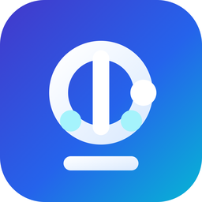
</p>

<h1 align="center">Vision for Windows</h1>

<p align="center">
  A native Windows coding agent that <em>is</em> the harness. It runs the tool loop itself and talks
  straight to an OpenAI-compatible model server — a DGX Spark or Strix Halo on your LAN, a local
  Ollama or LM Studio, a GLM, Kimi, DeepSeek, Qwen or OpenAI plan, Claude on the Anthropic API,
  Amazon Bedrock, or your organization's Guardian. No Node, no sidecar process, no web view.
</p>

<p align="center">
  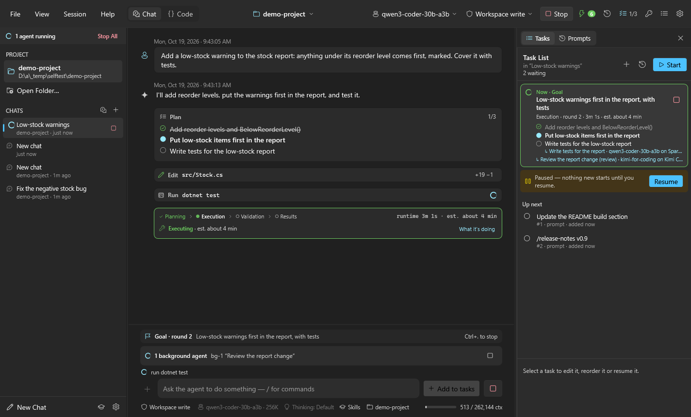
</p>

---

This is the Windows edition of [Vision for macOS](https://github.com/phastings503cm/vision-mac), written in C#
(.NET 10, WPF). The agent engine, tools, permission model, skills, plugins and conversation format
match the macOS app; the shell, terminal, paths, secrets and installer are Windows-native.

Vision was previously called DSH: installing Vision upgrades DSH in place and keeps your chats, settings and
keys, and a project's `.dsh` folder and `DSH.md` keep working.

```
you → Vision.Core.Engine → OpenAI-compatible /chat/completions → tool calls → files & shell → you
```

## Screenshots

| | |
|---|---|
| 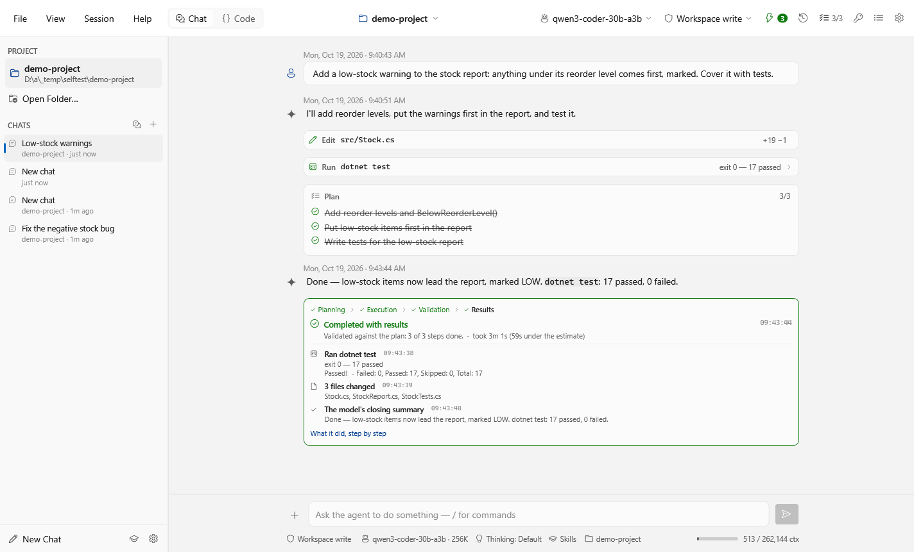 | 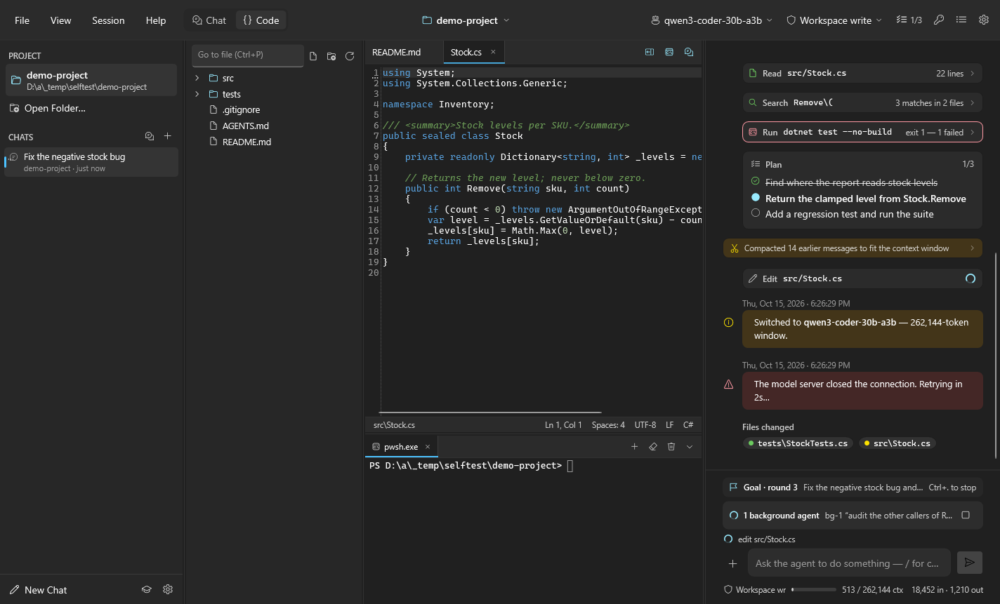 |
| A finished turn: how it ended, how long against the estimate, the evidence | Code mode: the chat is the main view; files, editor and terminal switch on and off |
| 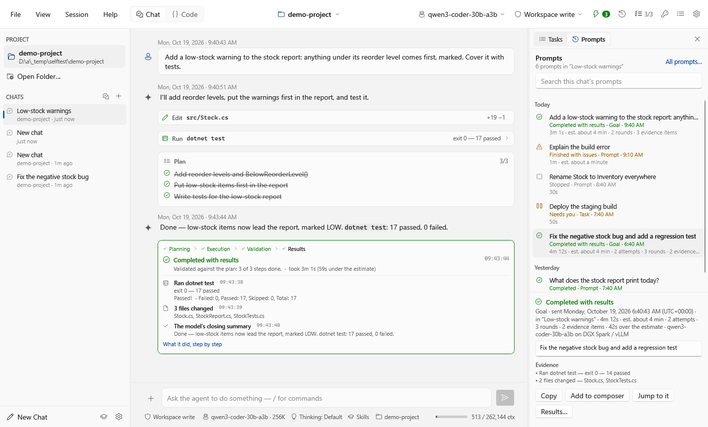 | 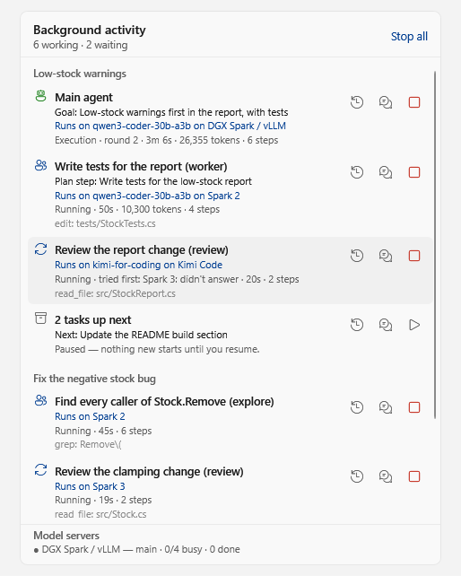 |
| Prompts: every prompt sent, and what came of it | Background activity: who is working on what, on which model |
| 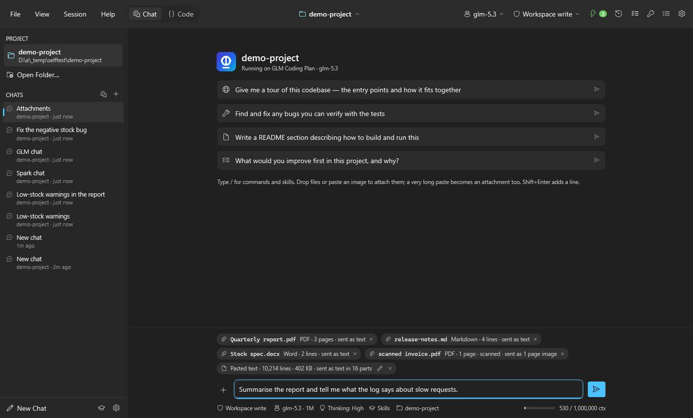 | 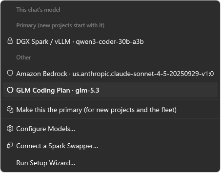 |
| Attachments: read by Vision, each chip says how it goes to the model | Each chat has its own model |
| 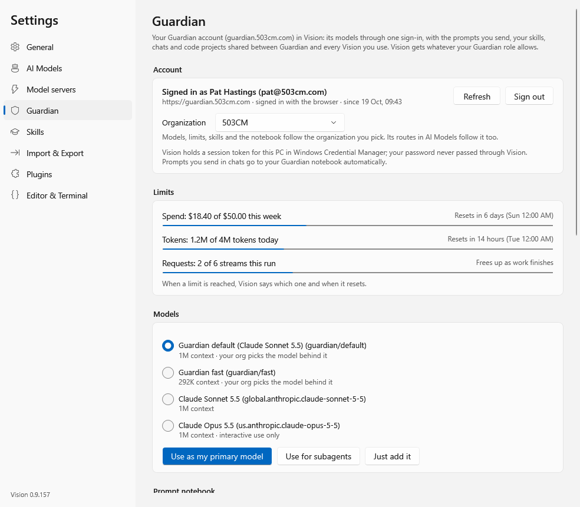 | 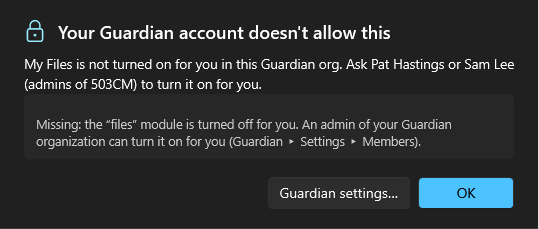 |
| Guardian: one sign-in for models, limits, prompts, skills and chats | When Guardian says no, Vision says why |
| 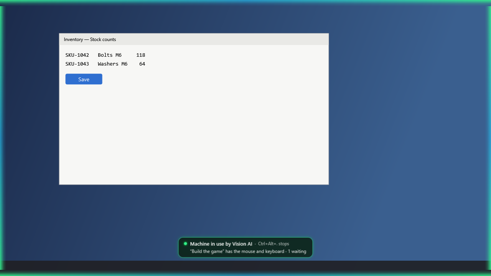 | 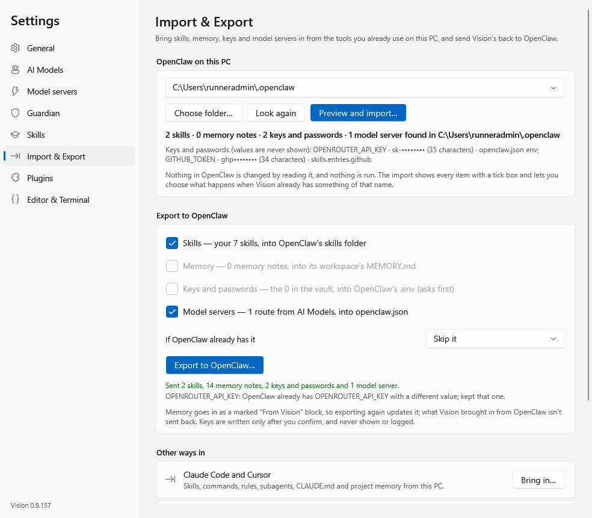 |
| Computer use: the glow, and one real mouse shared in turn | Import & Export with OpenClaw on this PC |
| 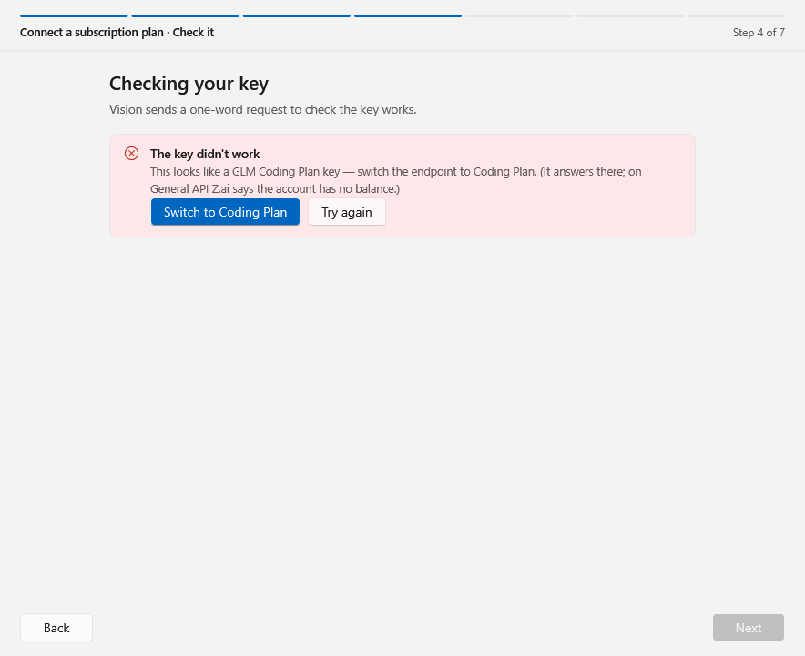 | 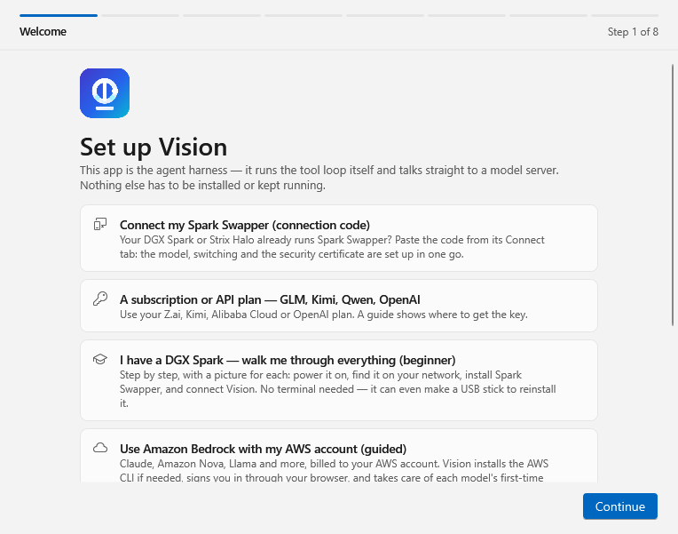 |
| Z.ai (GLM): a key on the wrong endpoint is found and switched | Setting up: a Spark Swapper code, a plan, Z.ai, a DGX Spark from scratch, Bedrock or Guardian |
| 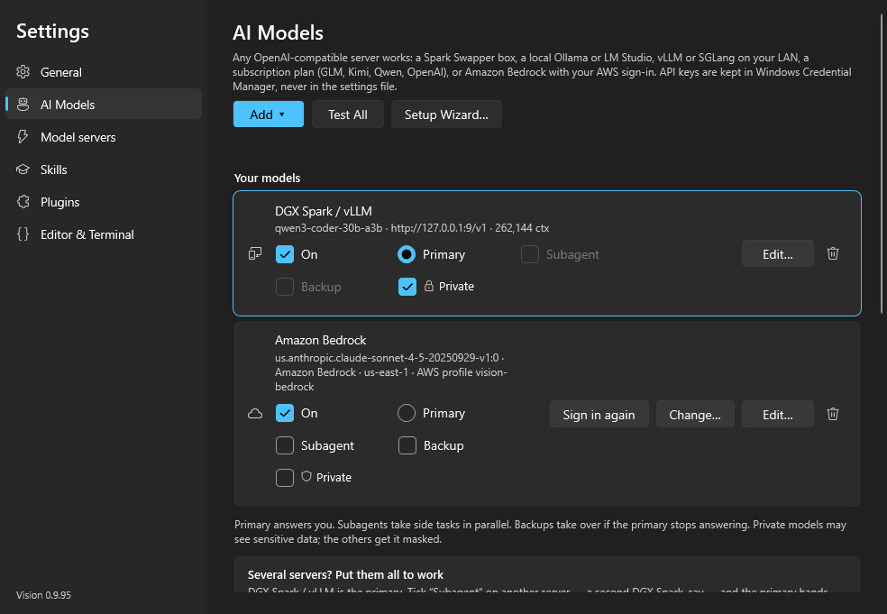 | 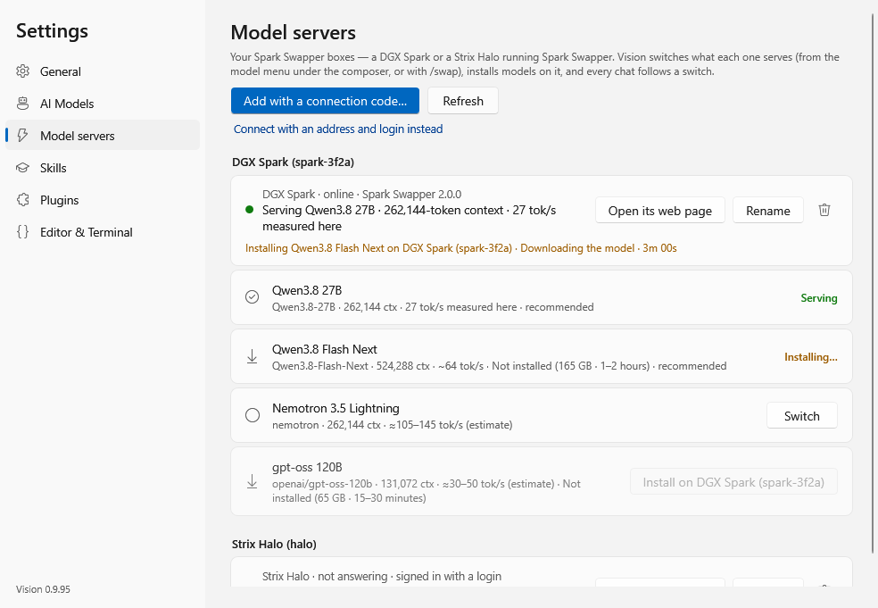 |
| AI Models: primary, subagents, backups and private routes | Model servers: what each Spark Swapper box serves and can install |
| 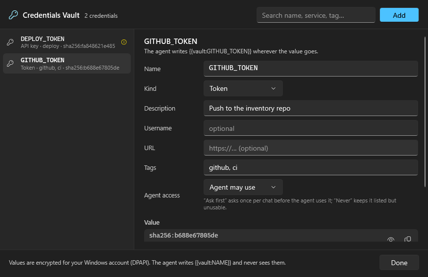 | 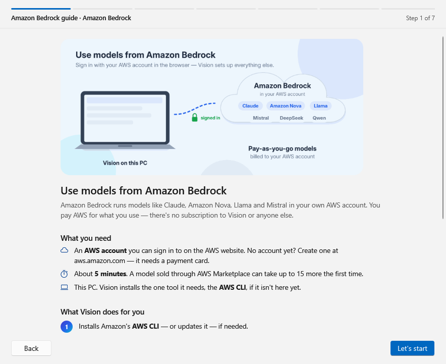 |
| The credentials vault: the agent writes `{{vault:NAME}}` and never sees the value | The Amazon Bedrock guide: sign-in, model access and terms, step by step |

These are taken by CI from the app's own self-test (`Vision.exe --self-test`, see
[Build from source](#build-from-source)) against a demo project, in light and dark; no model server is involved.

## Download

Every push to the default branch builds, tests and publishes a release. Get the latest from
**[Releases](https://github.com/phastings503cm/vision-windows/releases/latest)**:

| | Installer | Portable |
|---|---|---|
| **Windows x64** (most PCs) | `Vision-<version>-win-x64-setup.exe` | `Vision-<version>-win-x64-portable.zip` |
| **Windows on ARM** | `Vision-<version>-win-arm64-setup.exe` | `Vision-<version>-win-arm64-portable.zip` |

- **Installer** — no administrator rights needed (installs for your user under
  `%LOCALAPPDATA%\Programs\Vision`), adds a Start menu entry, and optionally **Open with Vision** on the
  folder right-click menu. Uninstall from *Settings › Apps*; your chats and settings stay.
- **Portable** — unzip anywhere and run `Vision\Vision.exe`. Put an empty file named `portable` next to
  `Vision.exe` to keep settings and chats in a `data` folder beside it instead of `%APPDATA%\Vision`. To upgrade a
  portable copy made under the app's former name, unzip Vision next to its folder (not into it) and add the
  `portable` file: the first start copies the old copy's data and leaves the old copy as it was.

Requires Windows 10 1809 or later, or Windows 11. Builds are self-contained (no .NET install
needed). They aren't code-signed yet, so SmartScreen may show *Windows protected your PC* — choose
**More info → Run anyway**. `SHA256SUMS.txt` in each release lists the checksums.

Vision checks for a newer release on startup (Settings › General › Check for updates) and offers a
download link; it never installs anything on its own.

## First run

The setup wizard runs on first launch and any time from **Settings › General › Run Again…** or
**Help › Run Setup Wizard…**. Eight steps: pick a backend, enter its address (and key, if your server
wants one), test the connection, choose a model, set the context window and default thinking level,
pin a permission preset, and optionally open a project folder.

| Backend | Address | Notes |
|---|---|---|
| Spark Swapper (DGX Spark or Strix Halo) | a connection code | **My Spark Swapper** — see *Connecting a Spark Swapper* |
| Z.ai GLM, Kimi, Qwen, OpenAI, DeepSeek, Anthropic plans | hosted | **A subscription or API plan** (DeepSeek and the Anthropic API also have their own cards) — see *Subscription plans* |
| DGX Spark / vLLM / SGLang / llama.cpp | `http://<host>:<port>/v1` | Port `8002` on a Spark set up with the guide |
| Ollama | `http://127.0.0.1:11434/v1` | Start the Ollama app or `ollama serve` |
| LM Studio | `http://127.0.0.1:1234/v1` | Developer › Start Server |
| OpenAI, OpenRouter | hosted | API key required |
| Amazon Bedrock | `https://bedrock-runtime.<region>.amazonaws.com` | Set up by its own guide — see below |

API keys are stored in **Windows Credential Manager**, never in the settings file. If a server on
another machine can't be reached, check it's bound to `0.0.0.0` rather than `127.0.0.1`, and that the
Windows firewall (on either machine) isn't in the way.

An agent needs a model that can call tools. Qwen3, Qwen2.5-Coder, and DeepSeek-V3-class models work
well; very small models struggle. Models without native function calling still work: tool calls
written as XML in plain text are recovered and run.

**Find Servers on My Network** on the connection step scans this PC and your network (each /24 your
PC is on, up to 1,024 hosts) for vLLM, SGLang, llama.cpp, Ollama, LM Studio and DGX Sparks, and fills
in the address of the one you pick.

## Connecting a Spark Swapper

[Spark Swapper](https://github.com/gnubyte/DGX-Spark-Swapper) 2.0 runs on a DGX Spark or an AMD Strix
Halo box, and gives out *connection codes*: on its page (`https://<box>:8999`) choose **Connect**, then
**Connect Vision**, and copy the code. In Vision choose **My Spark Swapper (DGX Spark or Strix Halo)** on the
wizard's first page — or **Settings › Model servers › Add with a connection code…**, or **Settings › AI
Models › Add › Spark Swapper (connection code)…** — and paste it:

1. **Check it** — Vision connects with the code's certificate fingerprint pinned (the box must show exactly
   that certificate) and says what the box is serving.
2. **Pick the model** — the box's models with their context and speed (*27 tok/s measured here*,
   *~58 tok/s*, or an estimate). A model the box doesn't have yet is marked *Not installed* with its
   download size and time; **Install on <box>** installs it, Vision follows the install, and then offers to
   start it. Picking another installed model offers to switch the box now (or keep what it serves).
3. **How should Vision use it?** — primary, subagent or backup (see *AI Models*), and private: it's your own
   hardware.
4. **Save and say hello** — the model route (`https://<box>:11443/v1` with the certificate pinned) and the
   box itself, for switching models. The app token and the model's key go to Windows Credential Manager,
   never the settings file.

A Swapper older than 2.0 has no connection codes: **Connect with an address and login instead** takes its
address (a bare host name or IP is fine), username and password. A 2.0 Swapper trades that login for an
app token labelled *Vision on <this PC>*, so the password isn't kept.

**Settings › Model servers** lists every box — DGX Spark or Strix Halo, online or not, what it serves and
its context, the Swapper version — with **Open its web page**, **Rename** and **Remove**, and each box's
models with **Switch**, or **Install on <box>** for one it doesn't have yet. The model menu under the
composer has a section per box (models that aren't installed are greyed out); picking a model asks that
box to switch, and every route at that box's address follows the new model. `/swap` lists every box's
models; `/swap <model>` switches the box behind the primary model, and `/swap <box> <model>` picks the box
by name. A Swapper that was reset, or that revoked Vision's token, is reported as such, with a button to
paste a fresh code. A Spark set up in an earlier version (one *Settings › DGX Spark* page) moves over by
itself, password and all.

## Setting up a DGX Spark

On the wizard's first page, **I have a DGX Spark — walk me through everything (beginner)** starts a
guide with a picture for every step, written for people who have never opened a terminal. It can be
closed at any point and picks up where you left off.

1. **What you need**, then **brand new or start fresh**. A new Spark ships with DGX OS: the guide
   walks through cables (power last), the Quick Start card's hotspot sticker, joining that Wi-Fi, the
   setup page (username, password, home Wi-Fi) and the ~10-minute update, while it watches your
   network for the Spark to come back. *Start fresh* makes NVIDIA's recovery USB stick for you: pick
   the recovery archive you downloaded from NVIDIA (`.tar.gz`, `.zip` or an unpacked folder) and a USB
   stick; Vision checks the files fit FAT32, asks Windows for permission (a small elevated helper,
   `Vision.exe --write-recovery-usb`, does the erasing — only USB disks between 8 and 256 GB that don't
   hold Windows are offered, and the disk is re-checked right before it is wiped), writes the
   known-good layout (MBR, one active FAT32 partition ≤ 31 GB labelled `BOOTME`,
   `EFI\BOOT\recovery.txt`) and shows how to boot from it.
2. **Find your Spark** — a network scan shows friendly cards ("DGX Spark at 192.168.1.42 —
   spark-3f2a"); an address can also be typed in.
3. **Install Spark Swapper** — Vision signs in over SSH with the account from the Spark's setup page
   (the host key is trusted on first use and remembered in `known_hosts.json`), runs
   [Spark Swapper](https://github.com/gnubyte/DGX-Spark-Swapper)'s one-line installer in a terminal,
   answers `sudo`'s password prompt itself (never shown or saved), and adds an nginx HTTPS front for
   the model API on port 11443 if there isn't one (Spark Swapper 2.0 writes its own, which Vision leaves
   alone).
4. **The padlock warning** — what a self-signed certificate is, why browsers say *Your connection
   isn't private*, why that's fine for your own Spark, and its fingerprint (checked against the
   certificate file on the Spark over SSH). Vision pins it; optionally Windows trusts it too.
5. **Your Swapper login** — creates Spark Swapper's admin account right away (the first visitor
   becomes admin).
6. **Get a model running** — the Swapper's models with their context and speed; one that isn't
   installed yet shows its download size and time, and **Install and start** installs it through the
   Swapper (following the Spark's log) before starting it.
7. **Connect Vision** — fetches the model's API key, saves the route
   `https://<spark>:11443/v1` with the certificate pinned, adds the Spark to Settings › Model servers
   (so `/swap` works) — with an app token from Spark Swapper 2.0 in place of your Swapper password —
   and says hello.

Later: manage the Spark at `https://<spark>:8999` or in Settings › Model servers; switch models with
`/swap`. Update Spark Swapper by running the guide again (*It's already set up* → *Reinstall or
update*); reset a forgotten Swapper login on the Spark with `sudo spark-swapper-reset-login`. Spark
Swapper logs: `journalctl -u spark-swapper -f` on the Spark.

The guide's pictures are drawn by `src/Vision.App/Assets/Guide/make_art.py`; the Spark Swapper
screenshots in them are from its repository (MIT, see `SWAPPER-SCREENSHOTS-LICENSE.txt` there).

## AI Models: primary, subagents and backups

**Settings › AI Models** lists every model route, each with an **On** switch and its roles:

- **Primary** (exactly one) answers you: the main agent talks to it.
- **Subagent** — subagents run there (below).
- **Backup** — *use if the primary fails*. When the primary doesn't answer a turn before saying anything
  (no connection, a timeout, 401/403, 404, 408, 429 or a server error), the same request goes to each
  backup in turn, and the chat says *Spark didn't answer (HTTP 503), so this turn ran on Kimi Code.*
  A turn is never switched halfway through; if every backup fails too, the usual outage retries take
  over. Subagents don't use backups — the fleet moves their tasks itself.
- **Private** (the lock) — the model may see sensitive data; every other model gets it masked (see
  *Sensitive data*). A route is private by default only when its address is on your own network:
  `localhost`, a private, link-local or Tailscale (100.64.0.0/10) address, a single-label host name, or
  a name ending in `.local`, `.lan`, `.home`, `.home.arpa`, `.internal` or `.ts.net`. Everything else —
  Bedrock and every plan included — is not private unless you switch it on.

A route that is off is never used and stays in the list, greyed; the primary can't be switched off
until another route is primary. **Add** offers a Spark Swapper (connection code), a subscription plan,
DeepSeek, the Anthropic API (key), Amazon Bedrock, or any other OpenAI-compatible server; **Test All**
checks every route that is on and shows the result as a dot beside it. The model menu under the composer
groups routes the same way (Primary, Subagents, Backups, Other), with a lock or a shield beside each, and —
while you are signed in to Guardian — Guardian's models under **Guardian** (see *Guardian*).

**Each chat has its own model.** Picking a model in the menu under the composer changes that chat only
(it is stored with the conversation): two projects open side by side can run on two different servers
at once. A new chat starts with what its project's chats last chose, else the primary — the primary is
what new projects start with and the main server subagents fall back to. Everything a chat does — its
turns, retries, `/goal`, its task list, compaction, its subagents when no subagent server is free —
uses that chat's model. The thinking menu offers only the levels the chat's model takes (GLM-5.3: Low,
High, Max; Kimi K2.6: Off, On; Kimi K2.7 Code: none — it always thinks).

When a server refuses a setting it doesn't take ("invalid temperature: only 1 is allowed for this
model"), Vision leaves that setting out, tries once more, remembers it for that server and model
(`request-adaptations.json` in the data folder), and says so in one line in the chat instead of failing.
Only optional settings are ever left out this way (temperature, thinking, max_tokens and the like): a
refusal that points at the messages, the tools or the model is reported as it is, and a lesson of that kind
saved by an earlier build is dropped when the file is read.

### Two or more model servers

Add a second DGX Spark (or any other OpenAI-compatible server) as another route in **Settings ›
AI Models** and tick **Subagent** on it. The route you are chatting with stays the *primary* — the main
agent talks to it — and the ticked routes become *workers*: subagents (`agent`, `delegate`, background
agents) run on the workers, least busy first and several at a time (the count is set per server),
while the main agent carries on with the primary. When every worker is busy, subagents may use the
primary too (a checkbox in the same place turns that off). A worker that stops answering is skipped for
a minute and its task moves to another server (told, if the task had already changed things, to look
before repeating a step), so one Spark going down doesn't lose a job; with a single server, a subagent
waits out an outage as long as the main agent does. One machine counts as one worker however many of its
models are listed, and editing a route never makes it the main model. Each worker
is asked which model it is serving right now, so a Spark that swapped models is still used correctly.
The Plan panel shows where each subagent runs, and `/agents` lists the servers with how busy each is.

The main agent is told which servers are private. Servers that aren't private must not receive
sensitive data: the agent describes their tasks in general terms, and sets `sensitive: true` on `agent`
or `delegate` when a task needs the real details — that task then runs only on a private server (or on a
private primary, when subagents may use it); with none free, the agent is told to do it itself or
rewrite the task without them.

### Sensitive data

**Mask sensitive data before sending it to models that aren't private** (on by default, in **Settings ›
AI Models › Sensitive data**). Before a request leaves this PC for a model that isn't private, Vision
replaces sensitive values with placeholders such as `⟦EMAIL_1⟧` — in the system prompt, every message,
tool results, earlier tool calls and text attachments — and tells the model to use them as written. What
comes back has the real values put back before you, the tools or the transcript see it, so the model can
still work with them; nothing is stored. The same value keeps its placeholder from turn to turn, and once a
value has been recognised anywhere in the conversation, every other place it turns up is masked too — in a
reply, a command or a tool's output, even run together with other text (`-phunter22x`).

- **What is masked** — each a switch: secrets and keys (private keys, AWS, GitHub, OpenAI, Anthropic,
  Slack, Google, Stripe and Spark Swapper keys, JWTs, bearer tokens, passwords in URLs, `password = …` and
  `"password": "…"` settings and `.env` lines — a bare value only when it looks like one, so code such as
  `let token: String` or `password = user_password` is left alone), email addresses, phone numbers, ID and
  card numbers (US SSNs, IBANs that pass their check, and card numbers that pass the Luhn check and start
  like a real card network's), IP addresses (off by default), and **custom terms**: one per line — client
  names, project code names — matched without regard to case on whole words, or a regular expression
  after `re:` (they are saved encrypted for your Windows account, not in plain text). Values in the
  Credentials Vault are always masked, even with the switch off.
- **Try it** shows exactly what a model that isn't private would receive for the text you type.
- A reply whose request had anything masked carries a small shield: *Masked 2 emails and 1 key before
  sending to Kimi Code* (hover for the categories — never the values).
- Attachments are checked as the text that is sent: what Vision read out of a PDF, an Office file or (with
  OCR) a picture, as well as text files whatever they were saved as (UTF-8, UTF-16, Windows "ANSI"). Only
  bytes that really go as they are can't be: a picture to a model that takes images, a PDF document to
  Bedrock. The first time a chat sends one to a model that isn't private it says so, and the shield's chip
  counts them as not checked.
- A Bedrock turn's saved reasoning, which Claude sees again word for word, isn't sent back if it holds a
  sensitive value (a turn made while the route was private, say).

## Subscription plans

**A subscription or API plan — GLM, Kimi, Qwen, OpenAI, DeepSeek, Anthropic** on the wizard's first page, or
**Settings › AI Models › Add › Subscription plan…**, walks through connecting one:

| Plan | Notes |
|---|---|
| Z.ai (GLM) | One provider, four endpoints: Coding Plan, General API, and both in China (BigModel). A Coding Plan key works only on the Coding Plan endpoint; if a key is on the wrong one, the check says which endpoint it belongs to and switches with one click. GLM-5.3 always thinks; Vision never asks it not to. Also in **Settings › AI Models › Add › Z.ai (GLM)…**, with an endpoint picker and a **Test** button. |
| Kimi Code (subscription), and Moonshot pay-as-you-go API | Overseas or China. Vision tells Kimi who is calling (`Vision/<version> (Windows)`) and never poses as another tool; if Kimi refuses that, the guide suggests the Moonshot API. |
| OpenAI API | A ChatGPT Plus or Pro subscription doesn't include API access — the API is billed separately. |
| Qwen — Alibaba Cloud Coding Plan, and Model Studio pay-as-you-go | International or China. Coding Plan keys start with `sk-sp-`. |
| DeepSeek API | `deepseek-v4-pro` (1M context, text) and `deepseek-flash` (V4.1 Flash, 1M, reads images). Also its own card on the wizard's first page and **Add › DeepSeek…**. |
| Anthropic API (Claude, with an API key) | `claude-opus-5-5` (recommended), `claude-fable-5-1`, `claude-sonnet-5-5`, `claude-haiku-5-5` — what the key's `/v1/models` lists. Also its own card and **Add › Anthropic API (key)…**. |

Pick the plan and region; the guide shows where to get the key, step by step (with a button to open
the page), checks the key you paste — saying what's wrong when it isn't accepted: the wrong region or
endpoint, a plan that doesn't allow this app, a usage limit — lets you pick the model (the
recommended one first), asks how Vision should use it (primary, subagent, backup, or just add it), saves
the route and says hello through it. The key goes to Windows Credential Manager. Plans are online
services, so they aren't private: Vision masks sensitive data before sending (*Sensitive data*, above).

Alibaba allows the Qwen Coding Plan only for interactive use, so its route is marked **Interactive use
only (plan terms)** (a switch in the route editor, for any route): while it is a chat's model, that chat's
task list won't start (or stops before its next task) and a `/goal` doesn't carry on by itself — pick
another model for the chat for unattended work — and unattended work never falls back to it as a backup or
sends subagents to it. Chats, the subagents they start, and prompts you queue with *Add to tasks* are fine.

- **DeepSeek.** The thinking menu maps to DeepSeek's switch and effort: *Off* sends
  `thinking: {"type": "disabled"}`, *Low* / *High* / *Max* send `"enabled"` with `reasoning_effort` `low` / `high` /
  `max` (*Medium* is `high`, as DeepSeek maps it). With tools, every earlier answer's reasoning goes back with the
  conversation, as DeepSeek requires; if DeepSeek still asks for reasoning a chat no longer has, that one turn runs
  without thinking and the chat says so. A key it refuses, an empty balance (402) and its rate limit are said in plain
  words, and only the last is retried. DeepSeek's servers are in China — the route starts out not private, so the
  shield masks before sending.
- **Anthropic API (key)** talks to Claude on the Messages API directly: streaming, tools, images, PDFs (up to 20 MB of
  pictures and PDFs per request, the message being sent first — past that one goes as its text), extended thinking
  (adaptive with summaries; Opus 5.5's *Off* is its lowest effort, Sonnet 5.5's is `between_tools`), prompt caching
  (after the system prompt, the tools and the conversation) and Anthropic's server-side fallback (a declined request
  moves to the model Anthropic recommends, with a line saying so). A request Claude declines is said in Anthropic's
  words. A Claude Pro or Max subscription isn't an API key — the guide says so if you paste a subscription token.

## Using Amazon Bedrock

On the wizard's first page, **Use Amazon Bedrock with my AWS account (guided)** — or **Settings ›
AI Models › Add › Amazon Bedrock…** — starts a guide for people who have never used the AWS CLI. All it
needs is an AWS account you can sign in to on the website.

1. **The AWS CLI.** Vision looks for it and installs it if it's missing (or updates it if it's too old
   for the browser sign-in, which needs 2.32 or later): Amazon's per-user MSI, no administrator
   prompt, with its Authenticode signature checked (signer *Amazon Web Services, Inc.*) before it
   runs. If that's blocked, it can install for all users (Windows asks for permission) or with
   `winget`.
2. **Sign in.** Pick a Region, then **Sign in with my browser**: Vision runs `aws login` into its own
   profile, `vision-bedrock`, so profiles you already have are left alone. Your browser opens to the
   AWS sign-in page; Vision never sees your password. Signing in on a PC without a browser works too
   (the CLI's `--remote` mode: open the link elsewhere and paste the code back). Already set up with
   IAM Identity Center (SSO), keys or a role? Choose **Use a profile I already have** — Vision runs
   `aws sso login` for SSO profiles. The guide then shows the account you're signed in to.
3. **Pick a model.** The Region's chat models (Claude, Amazon Nova, Llama, Mistral, DeepSeek, …)
   with the best of each family first, using a cross-Region inference profile where the model needs
   one. Vision checks what each one needs before first use.
4. **Enable it** — only when needed; most models are ready immediately:
   - **Claude** needs Anthropic's one-time *use case* form per AWS account. Vision asks the same
     questions (company, website, industry, who will use it, what for) and submits it
     (`PutUseCaseForModelAccess`).
   - **Marketplace models** show their offer first — price per unit, licence (EULA) link, refund
     policy — and are enabled only after you tick *I accept* and press **Accept and enable**
     (`CreateFoundationModelAgreement`).
   - Then Vision waits for AWS to finish (usually seconds, up to 15 minutes for a new subscription).
   If your AWS identity isn't allowed to do something, the page says which permission is missing
   and has a ready-made IAM policy to copy for your administrator.
5. **Connect** — saves the route (profile, Region, model) and says hello through Bedrock.

Requests are signed with SigV4 using short-lived credentials the AWS CLI exports for the profile
(`aws configure export-credentials`), refreshed before they expire; nothing secret is stored in
Vision's settings. Chats use Bedrock's Converse API with streaming, tools, images, prompt caching for
Claude and Nova, and Claude's extended thinking. When the sign-in runs out, the banner offers **Sign
in to AWS…** (the browser opens, and your next message goes through); **Settings › AI Models** has
**Sign in again** and **Change…** (another model, Region or account) for each Bedrock route.

Need a **Bedrock API key** for another tool? The guide's last page can create one from your sign-in
(valid up to 12 hours) and save it in the Credentials Vault as `AWS_BEARER_TOKEN_BEDROCK`.

Costs are billed by AWS to your account (Amazon Bedrock, and AWS Marketplace for Marketplace models).
To remove Vision's sign-in: `aws logout --profile vision-bedrock`.

## Guardian

**Settings › Guardian** (or *My Guardian account* on the wizard's first page) signs Vision in to your
organization's [Guardian](https://guardian.503cm.com): with your email and password (and the authenticator
code, when your account has one), or **Sign in with your browser…** for Microsoft and other single sign-on
accounts — Guardian's page opens, you choose the organization, and Vision gets a sign-in you can revoke
there (*Profile › API keys › Connected apps*). The sign-in is kept in Windows Credential Manager. Signed in,
Vision gets whatever your Guardian role allows:

- **Guardian's models in every chat** — once signed in, the models Guardian offers you appear by themselves in
  every chat's model menu under **Guardian**, no button to press, charged to you within your organization's
  limits through Guardian's model proxy. Any chat can pick one like any other model (Guardian's context window and
  plan terms come with it). The list is read again on every sign-in, on an organization switch and every 15
  minutes, and kept for the next launch (without the token). Signing out takes them out of the menus; a chat that
  was on one keeps it and says *Sign in to Guardian to use this model.* — signing in again renews the token for
  every chat on them. **Use as my primary model** and *Use for subagents* save a Guardian route in those roles.
  The page shows each spend, token and request limit, what is left and when it resets.
- **Prompt history** — every prompt, task and `/goal` goes to your Guardian Prompt Notebook when it starts and
  again with how it ended. Guardian isn't private, so the copy that goes up is masked like a request to a model
  that isn't: the keys and passwords in your vault always, and — with the sensitive-data shield on — whatever it
  masks. **Send my prompts to the notebook** (Settings › Guardian) turns it off.
- **Skills, chats and projects** — take your account's skills, deposit yours, export chats and bring them back
  (Vision for macOS reads the same format), and upload the open project (files that hold keys, such as `.env`,
  are never sent).
- **Secrets** — the ones you marked *Usable in Vision* in Guardian, used for this session only and never
  saved on this PC (every use is recorded in Guardian).

When Guardian says no, Vision says why in a dialog — what is missing and who can grant it, or which limit was
reached and when it resets — never as a bare HTTP code.

## Claude Code (your Claude plan)

**Settings › Claude Code** (or *Claude Code — your Claude Pro or Max plan* on the wizard's first page) puts
chats on the official [Claude Code](https://code.claude.com) app on this PC, so a Pro or Max plan does the
work. Vision runs `claude` in headless mode (`claude -p`, stream-json both ways) and never touches its sign-in:
it checks with `claude --version` and `claude auth status` (which say *whether* it is signed in), shows the
install and `claude auth login` steps when it isn't, and Claude Code talks to Anthropic itself. **Add Claude
Code** puts *Claude Code · Opus*, *Sonnet* and *Haiku* in every chat's model menu; pick one for a chat and:

- each message is one Claude Code turn in the chat's project folder, carrying on the same Claude Code session
  (`--resume`) — a chat that moves onto it part-way, or whose session is gone, starts a new one with a recap of
  the chat so far. Its replies, thinking, tool calls, file changes, todo lists and plans show as rows and in the
  plan panel, each with its time;
- the chat's permission setting decides: *Workspace write* lets edits inside the project and commands that only
  read go ahead and asks you on the chat's card for the rest; *Plan only* runs Claude Code in plan mode and shows
  its plan; *Full access* lets everything go ahead (a safety check Claude Code says needs a person still asks);
- `/goal` (one Claude Code turn per round), the task list, run phases, time estimates and the Prompts timeline
  work as with any model; Stop interrupts Claude Code's turn; `/compact` compacts its session;
- after each turn the chat says what it used: steps, tokens and Claude Code's own cost estimate — covered by
  your plan, unless Claude Code is set up with an API key (`ANTHROPIC_API_KEY`), which the chat then says it bills.

Vision's own one-off requests on it (a summary, a skill draft) go to Claude Code as a single request with
Vision's instructions and no tools; it is never a backup or a subagent server. **Sensitive chats can't use it** — it reads your files itself, so the
shield can't stand between them and Anthropic. Advanced: the `claude` path to use, and *Run Claude Code inside
WSL* for one installed in Linux.

## The window

**Chat** (Ctrl+1) — the transcript interleaves messages and tool calls in the order they happened,
each tool card expandable to its full output (a skill the agent uses shows as *Using the <name>
skill*). Every message — yours, the agent's, and the app's notices — shows the date and time it was sent
on this PC's clock, in your Windows date and time format (hover it for the full date and UTC offset).
Markdown renders with headings, code blocks (with copy), lists, quotes and tables. **Enter** sends,
**Shift+Enter** adds a line. Drop files on the chat or paste an image (Ctrl+V) to attach it. Under the
composer: the chat's permission preset, the model menu (with switching on each Spark Swapper box),
thinking level, skills, and a live context gauge.

**Attachments** are read by Vision, not handed to the model server as files (which no self-hosted server
takes): text and code as they are, PDFs page by page, Word, PowerPoint, Excel, OpenDocument and Rich Text
from their contents, and pictures and scanned pages with Windows' own OCR where Windows has a language for
it. Each chip says what will be sent — *report.pdf · PDF · 42 pages · sent as text*, *sent as image*,
*sent as 3 page images*, *sent as text (OCR)* — and the sent message keeps those badges. A model that takes
images gets pictures (scaled to at most 2,048 px); one that doesn't gets their text, and a server that
turns a picture down is asked again with the text. Bedrock keeps a short PDF as a document. A file longer
than a quarter of the model's context window goes as a contents list and its first parts; the rest is saved
with the chat (`%APPDATA%\Vision\attachments`) and the model reads it with the `read_attachment` tool.
A paste of more than 400 lines or 20,000 characters becomes a *Pasted text · 10,214 lines · 412 KB*
attachment instead of text in the box (the pencil views and edits it), and a very long message in an older
chat shows its first 40 lines, with *Show more* and *Show all* (in a window).

**Long chats** are paged: a chat opens on its newest 50 messages and tool cards, with **Load earlier
messages · 1,950 earlier** above them — scrolling to the top loads the page before, and the message you
were reading stays where it was on screen. Far back in a chat (or after jumping to an old message), **Load
newer messages** and **Jump to latest** sit at the bottom; scrolling down brings the newer pages back. A
very long message — a 10,000-line paste, a huge tool output — shows its first lines and **Show more ·
10,174 more lines**; opened, anything past 800 lines is read in a box of its own height (the wheel scrolls
it, then the chat), so no single message can make the window slow or hard to scroll. **Ctrl+F** finds text
anywhere in the chat, loaded or not, and jumps to each match (Enter for older, Shift+Enter for newer).

**Copy** any message: hover it for its **Copy** button, right-click it for *Copy prompt* / *Copy reply*, or
click into it and press **Ctrl+C** with nothing selected. A prompt is copied whole, as you sent it (with the
text of a large paste it carried), even while the chat shows only its first lines; the button says *Copied*.

**Chats without a project** (File › New Chat Without a Project, Ctrl+Shift+N, or the chat button in the
sidebar — even while a folder is open) are regular conversations: the model is told no project folder
is needed and answers directly, using the web, your skills and long-term memory when they help. Your own
instruction files, skills and plugins apply; a project's don't. When something needs files or
commands, the chat works in a scratch folder of its own, `%APPDATA%\Vision\Chats\<chat id>` — made on
first use, treated by the permission preset like a project folder, and moved to the Recycle Bin when the
chat is deleted. Its task list runs in the chat too, so its tasks work in that folder. Its first screen
offers openers like *Explain something simply* or *Summarise a web page* (and your skills), with a link
to open a folder for code.

**Code** (Ctrl+2) — the chat is the main view, with a project status bar above it: the project, its
branch, what the agent is doing (the step it is on, waiting for permission or an answer, how far through
its plan) and the files it changed, and switches for **Files**, **Editor**, **Terminal** and **Chat only**
(Ctrl+Shift+F hides all three; again brings them back). Opening a file shows the editor in the centre with
the chat beside it; closing the last one gives the centre back to the chat (Ctrl+Shift+D toggles the
editor). The terminal runs under both.

- **File tree** — lazy, filterable (Ctrl+P), live-updating as the agent or a build writes files.
  Right-click to open, reveal in Explorer, rename, create, delete (to the Recycle Bin), open a
  terminal there, or mention the file in the chat as `@path`.
- **Editor** — tabbed, with syntax colours, line numbers, find/replace (Ctrl+F / Ctrl+H), and a
  remembered position per file. Files keep their line endings (CRLF or LF) and byte-order mark. When
  the agent rewrites a file you have open, a clean tab just follows it; a tab with unsaved edits
  shows **Reload from Disk** / **Keep Mine** instead of being overwritten.
- **Terminal** (Ctrl+\`) — real shells on ConPTY (PowerShell by default; Windows PowerShell, cmd,
  Git Bash or any command line in Settings), with colour, the alternate screen, and scrollback.
  Ctrl+Shift+C / Ctrl+Shift+V copy and paste; Ctrl+C copies when text is selected.

Open tabs, the terminal panel and which panes show are remembered per project. F1 lists the keyboard
shortcuts.

**Task Queue** (Ctrl+Shift+Q, or the list button in the top bar) — a panel on the right for work
that should happen unattended. **Credentials Vault** (Ctrl+Shift+K, or the key button) — the API
keys and passwords the agent may use. Both are described below.

**Plan** (Ctrl+Shift+P, or the checklist button at the top right, whose counter shows how many steps
are done) — a panel on the right that lays out what the agent is working through in the chat you're
looking at: what it is doing right now, the goal it is on, the steps of its plan ticked off as it
goes, a plan proposed in *Plan only* mode, and the subagents it has running and which model server each
is on. It reads the agent's `todo_write` list, or a plan written in a reply ("Here's my plan: 1. …
2. … 3. …"). It opens by itself the first time a chat makes a plan; a checkbox at the bottom turns that
off. While it is open, the plan card in the transcript shrinks to one line (*Plan updated — 3 of 7 done
· Show*), so the plan isn't shown twice.

**The turn card.** Every prompt runs *Planning → Execution → Validation → Results*, shown on a card under
the newest message: the phases (the one in progress pulses), the runtime against an estimate learned from
how long the same kind of work took before on this PC (and across your organization when you are signed in
to Guardian), the plan's draft while it is written, what the agent is doing step by step, and at the end
*Completed with results*, *Completed* or *Finished with issues*, how long it took against the estimate, and
the evidence: the checks it ran (*Ran dotnet test*), the files it changed, its closing summary. A `/goal`
or a task that says it is done while its own closing words report a failure is sent back to fix it and
check again — as often as it takes, unless two attempts in a row make no progress on the same failure.

**Prompts** (Ctrl+Shift+H, the history button in the top bar, or the *Prompts* tab beside *Tasks*) —
every prompt sent in the chat, newest first under day headings: how it ended, how long it took against its
estimate, attempts, the model and route it ran on, and its evidence. Search it; select one to **Copy** it,
**Add to composer** (quoted with how it ended), **Jump to it** in the transcript, or open its **Results**.
**All prompts** (Ctrl+Alt+H, or *Session › All Prompts…*) searches every chat on this PC; double-click one
to open it in its chat. Prompts sent before this version are filled in once from the chats' transcripts.

**Background activity** (Ctrl+Shift+A, or the bolt in the top bar, which counts what is working) — what
every agent is doing, grouped by chat: each main agent, subagent, background agent and task list, what it
was given (the goal, the prompt, the plan step), the model and route it runs on and why there (*tried
first: Spark 2: didn't answer*), its status, time, tokens and current step, with **Log**, **Open its
chat** and **Stop**. **Stop all** is at the top and each model server's load at the bottom. The Plan panel
lists the subagents working each step (*↳ Write tests · qwen3-coder on Spark 2*): the step the `agent` (or
`delegate`) call names with `step` (its number in the plan or its text), else the open step whose words match
the subagent's task best — and none, rather than a wrong one, when two steps match it equally.

## Permissions

| Preset | What happens |
|---|---|
| **Workspace write** (default) | Reads anywhere. Writes inside the project run without asking; outside it, the agent asks. Shell commands that only read run; anything that looks like it changes something asks. |
| **Plan only** | Every write and every command asks, and the agent is told to research and return a plan. |
| **Full access** | Writes and runs without asking. For projects you'd hand the keys to. |

Each chat keeps the preset it was created with. The agent's commands run in the shell chosen in
**Settings › General › Agent shell** (PowerShell 7 when installed, otherwise Windows PowerShell), and
the agent is told which shell it is so it writes commands for it.

## Tools

The core tool set matches [Qwen Code](https://qwenlm.github.io/qwen-code-docs/en/developers/tools/introduction/)
name for name: `read_file`, `read_many_files`, `write_file`, `edit`, `list_directory`, `glob`,
`grep`, `run_shell_command`, `web_fetch`, `todo_write`, `exit_plan_mode`, and `agent` (a subagent for
a scoped task). On top of those:

- **Background subagents** — `agent` with `run_in_background: true` works while the main agent
  carries on (up to four at once). `agent_status` checks on them or waits for one, `agent_stop` ends
  one. When they finish, the main agent is told automatically; an idle chat picks the work back up
  by itself. A bar above the composer shows what is running, with a stop button.
- **Long-running programs** — `process_start`, `process_read`, `process_write`, `process_stop`,
  `process_list`: dev servers, game engines, REPLs and watchers run in a pseudo console and keep
  running between tool calls. The agent reads their output (optionally waiting for a line to appear),
  types into them, and stops them with Ctrl+C, then the whole process tree. They end with the app.
- **Seeing and using the PC** — `screenshot`, `list_windows`, `screen_watch`, `ui_tree`,
  `inspect_process`, `view_image`, `mouse`, `keyboard`, `focus_app`, for testing what the agent
  built. Each chat asks before the first look and the first click (full-access chats don't). Typing
  into terminals, the Run box, Explorer or Task Manager is always refused. Switch them off in
  **Settings › General › Computer use**.
  - **Your mouse stays yours.** Clicks and typing go to the app in the background where they can —
    UI Automation on the button, check box, list item or field, or messages to a standard Win32
    control — so the cursor doesn't move, the app doesn't have to be in front, and several chats can
    work at once. Only what needs the real mouse or keyboard (games, drags, right-clicks, shortcuts)
    uses them: one chat at a time (the others say "Waiting for the mouse"), never while you are using
    them, and the cursor goes back where you left it — and so does the window you had in front.
    **Keep each chat to the apps it started** (same page) limits a chat's input to programs it launched.
  - **Each chat's input goes to its own window.** A chat that took a screenshot of a window (or read
    its tree, or named it) clicks into *that* window by coordinates, even where your window or another
    chat's app covers the point, and a point outside it on another app is refused rather than clicked.
    Keystrokes without an app go to the field the chat last clicked or the window it last used — never
    to whatever you have in front (with neither, the agent is told to name the app). Text ending in a
    line break is typed and then submitted: Enter in a web form's field presses the form's one submit
    button in the background. Parallel subagents of one chat each keep their own field and window.
    Vision's own windows are never clicked or typed into, so a chat can't answer its own permission
    question.
  - **The glow.** While a chat uses the computer, the edges of every monitor glow and a label says
    *Machine in use by Vision AI*, which chat has the mouse or works in the background, and that
    **Ctrl+Alt+.** stops — from any app (when another app holds that key, the label says **Ctrl+Shift+.**
    in Vision stops all). A click or keystroke waits for the glow to be on screen first (up to half a
    second). The glow is left out of the agent's screenshots.
- **`queue_task`** adds follow-up work to the chat's own task list; **`vault_search`** finds credentials by
  name (never their values).
- **Kinds of subagent, and fan-out** — `agent` takes an `agent_type`: `general` (the default),
  `explore` (read-only search), `plan`, `review`, `worker`, or your own. Your own are Claude
  Code-style agent files — a `*.md` with `name`, `description`, `tools`, `server` and `max_steps` in
  its frontmatter and the instructions as the body — in `%APPDATA%\Vision\agents`,
  `%USERPROFILE%\.claude\agents`, or a project's `.vision\agents` / `.claude\agents`. (A file with no
  `tools` line gets every tool; a `tools` line that is blank, or names only tools Vision doesn't have,
  gets just the ones that read.) Several `agent` calls in one turn run at the same time, and
  `delegate` hands a list of independent tasks out and returns every report together. `/agents` shows
  what exists and what is running.
- **`memory_save`, `memory_search`, `memory_forget`** — the agent's long-term memory (see *Remembered
  notes*). **`goal_complete`, `goal_blocked`** are offered only while a `/goal` runs.
- **A result cache** — a file read again a moment later, or a search repeated before anything has
  changed, is answered from a per-chat cache instead of being redone and sent to the model a second
  time. It only reuses an answer it can prove is still right (a file's timestamp and size are
  unchanged; any write or command, a new message from you, or a background agent reporting clears the
  cached searches; a search asked a third time runs again; pages on this PC or the local network are
  never cached), and the Plan panel shows what it saved.

Plugins add more (below).

## Task lists

Every chat has its own **task list** (the panel on the right, **Ctrl+Shift+Q**; it shows the chat
you're in). Line up work — one task per item — and press **Start**: the chat works its tasks one at a
time, top to bottom, *in that chat*, each as an unattended goal that runs until the model declares it
complete. Each task sees the conversation so far, including what the tasks before it did. If you're
mid-turn when the list starts, your turn finishes first. Several chats can work their lists at the
same time; the toolbar's list button shows a dot while any of them is running.

A task that needs you is marked blocked and that chat's list pauses, so the next task doesn't talk
over the question: answer in the chat and press **Resume** on the task. Drag waiting tasks (or use
the arrows) to reorder them; edit or delete any task that isn't running. The log (the clock button)
records when each task started, every round, retries, and how it ended, with token counts and speed.

**Add to tasks while it works.** The composer stays open while the agent works: **Enter** puts what you
typed on the chat's tasks (the Send button becomes **Add to tasks**, beside Stop), and **Ctrl+Enter** does it
any time. Each runs as the chat's next prompt exactly as written — a `/goal` stays a goal, a skill runs — as
soon as the chat is free, in order, and you can keep adding while the list moves. The Tasks tab starts with a
**Now** card for what the chat is doing — the prompt, `/goal` or task, its phase and runtime against the
estimate, its plan steps and the subagent on each — then *Up next* and *Done*. A Stop, a failure or a goal
that needs you pauses the rest (*Paused — you stopped the current work.*) until **Resume**, and after a
restart they wait for Resume too. A queued prompt takes its attachments with it — files, pictures and a
large paste's chip (a 10,000-line prompt goes on the list like any other): they are kept in the chat's
attachments folder until the task is deleted and are read and sent with the prompt when its turn comes. A
queued prompt whose chat's model server is switching models waits for it, and runs once it's ready.

Task lists are saved to `task-queue.json` and survive restarts: if the app quits or crashes mid-task,
the task goes back in line and that chat's list picks up where it left off on the next launch (unless
you had pressed Stop). Three failed tasks in a row pause a list. Deleting a chat deletes its list.
Windows is kept awake while a list runs. Permission questions in a task are answered "no" after five
minutes, so an unattended run never stalls on one. Tasks queued before lists were per chat are moved
into a chat called *📋 Earlier tasks* (one per project folder) the first time this version starts.

## Credentials vault

Keep API keys, tokens and passwords in the vault and the agent can use them without ever seeing
them: it writes `{{vault:NAME}}` wherever the value goes — a shell command, a `.env` file, a request
header — and Vision substitutes the real value only when the tool runs. Tool output shows
`[vault:NAME]` instead of the value, so the secret never reaches the model, the transcript or the
logs. Each credential is **Agent may use**, **Ask first** (once per chat) or **Never**. Values are
encrypted for your Windows account with DPAPI; the window shows a fingerprint until you reveal a
value, which asks for Windows Hello or your Windows password first.

## Model outages

When the model server is down, restarting, or switching models, requests are retried automatically
— after 2, 4, 8, 16 and then every 30 seconds — until it answers, and the chat shows the countdown.
Press Stop to give up. Nothing already done is lost: tool calls that ran stay in the conversation.

## Slash commands

| Command | What it does |
|---|---|
| `/goal <task>` | Works on the task round after round, with no round limit and nobody typing "continue", until the agent calls its `goal_complete` tool (models that can't call tools end a reply with `GOAL_COMPLETE` instead). If it needs you it calls `goal_blocked` and waits: your next message is the answer, and the goal carries on with it (even after a restart); `/goal stop` drops a paused goal instead. Outages are retried; Ctrl+. stops it. A bare `/goal` picks an unfinished goal back up. |
| `/queue` | Starts this chat's task list (or says what it is doing). |
| `/compact [focus]` | Summarizes the conversation now. Long chats also compact automatically at 75% of the window. |
| `/think off\|low\|medium\|high\|max\|default` | Thinking level for this chat. |
| `/context` | Window size, usage, and where the window figure came from. |
| `/swap [box] [model]` | Lists every Spark Swapper box's models, or switches one: the box behind the primary model, or the box named. |
| `/skills` · `/skill <name>` · `/skill new <what>` · `/<name> args` | List skills, select one for this chat, have the model write one, or run one. |
| `/remember <note>` · `/memory [search]` | Save a note to long-term memory, or open the remembered-notes window (with a search word: list the matches). |
| `/agents` | The kinds of subagent, the model servers they run on, and what is running now. |
| `/sensitive [on\|off]` | Shows or sets whether this chat is Sensitive: then it uses only private models (your own hardware, Guardian, Amazon Bedrock in your AWS account) or others through the shield; engines that read files themselves, like Claude Code, are refused with the reason. |
| `/help` | Lists these. |

### No "continue"

A chat doesn't stop after a fixed number of steps and wait for you to say "continue": the step limit is
only a checkpoint, and the agent carries on until it has answered. So does a reply the model's output
limit cut short (a tool call cut off mid-way is never run — the agent is asked to send it again in
smaller pieces), and a chat whose background subagents have just finished. What does stop a run is you
pressing Stop, the agent saying it needs you, or it going in circles: the same call with the same
result again and again — even when it alternates between two calls (a longer cycle of up to eight
different calls is caught too, a little later), or a todo update comes between, or every attempt fails
with the same error — or a call you keep refusing. The agent is warned at the fourth
repeat and the run ends at the eighth; Vision then says why and waits for a new direction, and a `/goal`
that goes in circles for three rounds in a row pauses the same way. (Waiting on something — a command
with `sleep` in it, polling a process or a background agent — is not going in circles, up to a point: the same wait
giving the same answer twenty times gets a note and forty ends the run, and a wait that *fails* is not waiting. Neither is a
check that gives the same answer after every real edit, like a quiet build — including an edit made by running a
script or a generator with new arguments; one that keeps *failing* the same way is a loop.) As a last backstop a single turn stops
after 360 steps; a `/goal` simply carries on in its next round. `goal_complete` counts only when it is
the only call in its turn, so the agent has seen the results of everything else first.

## Bringing in Claude Code and Cursor

If Claude Code or Cursor is on your PC, Vision offers to bring your setup across: once, with a notice at the
top of the window, and any time after that from **Session › Bring in from Claude Code & Cursor…**,
**Settings › Skills**, or **Memory & Skills**. It looks in `%USERPROFILE%\.claude` and
`%USERPROFILE%\.cursor` (or wherever `CLAUDE_CONFIG_DIR` points), lists what it found with the new,
safe items already ticked, and **Import** copies them into Vision. Nothing in those folders is changed and
nothing is run.

| Found | Becomes in Vision |
|---|---|
| `CLAUDE.md` in Claude Code's folder (your global instructions) | One of **your instructions** (`%APPDATA%\Vision\instructions`): read on every request, in every project and in chats with no folder. Edit it in *Memory & Skills*. |
| Skills — your own and those of installed plugins, from both tools | Vision skills, with their bundled files. |
| Commands (`/name`) | Skills only you run, by typing `/name` in a chat. |
| Rules (`.claude\rules`, `.cursor\rules`) | Rules: always on, or attached to the files they name. |
| Subagents | Skills that tell the agent to hand the work to a subagent (the `agent` tool) with those instructions. |
| The notes Claude Code saved per project (`.claude\projects\<project>\memory`) | Notes for that project (`%APPDATA%\Vision\project-notes`), kept out of the repository. When you open the project, the model is shown the `MEMORY.md` index and reads the notes it needs. |

Only installed plugins count (Claude Code's install list, or Cursor's plugin cache); one installed for a
single project isn't ticked. Cursor's own built-in skills are listed but not ticked. Anything already in
Vision shows as *Already in Vision*, so running the import again changes nothing. If a skill has changed since,
ticking it keeps both, the second under a numbered name (`review-2`) and switched on. Notes Claude Code
has added to since show as *Updated since* and aren't ticked; updating them, or re-importing changed
instructions, keeps the files it replaces beside them as `.bak`. **Let me approve skills first** holds
skills in *Settings › Skills › To approve* instead of switching them on, and they show as *Waiting for
your approval* until you decide.

Listed at the bottom of the window and left alone: MCP servers (Vision can't run them yet), hooks,
tool-permission rules, conversation history, and what Cursor keeps inside its app (User Rules and
Memories). Anything that looks like a key or token, including in a file bundled with a skill (a `.env`, a
`.pem`), isn't ticked for you, because instructions and notes go to your model provider with each
request. A plugin's files and folders that are links to elsewhere on the PC are skipped. Claude Code
running inside WSL keeps its files on the Linux side; use *Somewhere else…* in the window to point at
them.

## Bringing in OpenClaw

**Session › Bring in from OpenClaw…** copies what an OpenClaw install has learned into Vision: its
**skills**, its **memory** (`MEMORY.md`, the daily logs, `USER.md` and the like, cut into searchable
remembered notes), the **keys and passwords** in its configuration (into the Credentials Vault, *ask
first* unless you choose otherwise) and its **model servers** (as routes). The first page asks where it
runs:

- **This PC** — Vision looks in the usual places (`~/.openclaw`, the older `.clawdbot` and `.moltbot`
  names, profile folders such as `.openclaw-work`, `OPENCLAW_STATE_DIR`), inside each WSL distro
  (`\\wsl.localhost\<distro>\home\<user>\.openclaw` and `/root` — OpenClaw's own Windows guide recommends
  WSL2; what is found there says *in WSL (Ubuntu)*) and, failing that, searches for `openclaw.json`.
- **Another computer (over SSH)** — give an address (a name from your `~/.ssh/config` works) and a
  password or key file, or leave both blank to try the keys in your `~/.ssh` folder. Vision signs in,
  finds the install the same way (Docker bind mounts and the usual `/data`, `/app` and `/home/node`
  places included), and reads the files over SFTP — or with shell commands on a server that has none —
  fetching only what you tick. The server's host key is trusted on first use, remembered in
  `known_hosts.json`, and refused if it ever changes.

If it can't find the install, *A folder to look in* takes the path. Nothing is copied until you press
the button, and nothing on the other machine is changed or run. Keys and passwords go straight into the
encrypted vault and are never shown or logged. Nothing that looks like a credential is carried across
anywhere else: notes that hold one are left out, and so are the files of a skill that do (`.env`, private
keys, a file with a key inside) — the window says which. Skills that bundle scripts can be held for
approval in **Settings › Skills** (importing never runs a script); importing again updates notes rather
than duplicating them, and a skill that hasn't changed isn't copied twice.

**Settings › Import & Export** works with OpenClaw on this PC in both directions. It shows what it found
there; **Preview and import…** brings it in as above, and **Export to OpenClaw…** sends Vision's skills, its
remembered notes (as a marked block in OpenClaw's `MEMORY.md`, which an export again updates in place), its
keys and passwords (into OpenClaw's `.env`, only after you confirm — they are plain text there) and its
model servers (into `openclaw.json`, after a backup; a file with comments gets a separate file to paste
from) — to the install you pick, inside WSL too. When a name is already taken, you choose: keep both, replace
what is there, or skip it.

## Remembered notes

Vision keeps a long-term memory that survives between chats: short notes about you and your projects — *the
staging server is called orion*, *tests run with `npm run t:unit`*, *the user prefers tabs*. Nothing is
loaded up front, so a long list costs nothing. When you send a message, Vision searches the notes (full
text with word stemming, weighted by how well they match, how recent they are and how often they have
helped) and puts the few that bear on it in front of the message inside `<recalled_memory>` tags: at
most four, about 600 tokens, none twice within eight turns, and nothing at all when nothing matches. The
chat shows a one-line *Remembered 2 notes: …* when it happens.

Notes come from you (`/remember the staging server is called orion` — it belongs to the project the
chat works in; start with `global:` for a note that applies everywhere — or **Session › Remembered
Notes…** to add, edit, pin and delete them), from the agent (`memory_save` when it learns something
durable and non-obvious; `memory_search` and `memory_forget` to look things up and correct them) and
from OpenClaw. They are plain text in `%APPDATA%\Vision\memory`. Anything that looks like a key or a
password is refused, whoever wrote it and however it got there (an import, a mirrored file) — that
belongs in the vault. Saving a note that repeats one of the agent's own updates it, but the agent never
rewrites a note you wrote or pinned (it adds its own beside it), can't pin a note, and can't delete one
of yours — or one you've pinned or edited — without asking; in *Plan only* mode it can look things up
but not change them. What a note says is shown to the model as reference data, never as instructions. A *pinned* note is always in the system prompt, for a few
standing facts (the window warns when more are pinned than fit). A large `MEMORY.md` or daily log in a
project is cut to its opening in the prompt and made searchable, so it no longer takes over the window;
the searchable pieces follow the file (trim the file and they go), and can be deleted in the notes
window. The switch is at the top of the notes window.

## Memory, skills and plugins

**Instruction files** in the project root are loaded into every prompt: `AGENTS.md`, `QWEN.md`,
`CLAUDE.md`, `.claude/CLAUDE.md`, `CLAUDE.local.md`, `.cursorrules`, `VISION.md`, `MEMORY.md`, and
today's `memory/YYYY-MM-DD.md`. Your own instruction files in `%APPDATA%\Vision\instructions` (any `*.md`)
are loaded into every prompt in every project, ahead of the project's — and in chats without a project.
**Session › Memory & Skills…** (Ctrl+Shift+M) edits them all and shows the exact system prompt; in a chat
without a project it shows your own files and skills.

**Skills** are folders with a `SKILL.md` — the format Claude Code, Cursor and Agent Skills share, so
Vision reads their folders in place (`.claude`, `.cursor`, `.agents`, `.qwen`, and `%USERPROFILE%`
equivalents) alongside its own (`<project>\.vision\skills`, `%APPDATA%\Vision\skills`). The Skills button
under the composer picks the skills a chat uses; **Settings › Skills** switches them on or off, edits,
generates new ones with the model (nothing is active until you approve it), and imports from a
folder, a zip, a file or a GitHub link, or exports for Claude Code, Cursor or Agent Skills. One skill
ships with the app: **godot-debugging**, which runs a Godot game, reads its output and drives it
with the computer-use tools.

**Plugins** are JSON manifests declaring tools backed by shell commands — drop one in
`%APPDATA%\Vision\plugins` or `<project>\.vision\plugins` and reload in **Settings › Plugins**.

```json
{
  "name": "dotnet",
  "description": ".NET helpers",
  "tools": [
    {
      "name": "dotnet_test",
      "description": "Run the test suite. Use after changing code.",
      "parameters": {"type": "object", "properties": {"filter": {"type": "string"}}},
      "command": "dotnet test --filter ${filter}",
      "requiresApproval": false
    }
  ]
}
```

## Where things live

| What | Where |
|---|---|
| Settings, conversations, skills, plugins, crash logs | `%APPDATA%\Vision` (or the portable `data` folder; `VISION_HOME` overrides both) |
| API keys, Spark Swapper app tokens and passwords | Windows Credential Manager (`Vision/…` entries; a Swapper's under `Vision/swapper/<id>`) |
| Scratch folders of chats without a project | `%APPDATA%\Vision\Chats\<chat id>` |
| Attached files' text (read back with `read_attachment`) | `%APPDATA%\Vision\attachments\<chat id>` |
| Your instructions (every project) | `%APPDATA%\Vision\instructions\*.md` |
| Remembered notes | `%APPDATA%\Vision\memory\memories.jsonl` |
| Your subagent types | `%APPDATA%\Vision\agents\*.md` |
| Notes imported per project | `%APPDATA%\Vision\project-notes\<project>` |
| Task lists (every chat's) | `%APPDATA%\Vision\task-queue.json` |
| Credentials vault | `%APPDATA%\Vision\vault.json` (names and details) and `vault.bin` (values, DPAPI-encrypted) |
| Program | `%LOCALAPPDATA%\Programs\Vision` (installer) |

## Build from source

Needs the [.NET 10 SDK](https://dotnet.microsoft.com/download). The app builds on Windows; the core
library and its tests also build and run on Linux and macOS.

```powershell
dotnet build Vision.sln
dotnet test tests/Vision.Core.Tests
dotnet test tests/Vision.App.Tests       # Windows: task lists, /goal, background agents, vault
dotnet test tests/Vision.Windows.Tests   # Windows: screenshots, windows, mouse and keyboard
dotnet run --project src/Vision.App
```

To produce the release files locally (installers need [Inno Setup](https://jrsoftware.org/isinfo.php) 6.3 or later;
6 and 7 both work):

```powershell
./scripts/package.ps1                          # x64 + arm64: installers, portable zips, SHA256SUMS
./scripts/package.ps1 -Arch x64 -SkipInstaller # just a portable x64 build
```

`dotnet test tests/Vision.Core.Tests` runs the core tests anywhere (3,504 on Linux, 25 of them Windows-only and
skipped there; 3,498 on Windows, 48 skipped). The app tests (156) and the computer-use tests (121) need Windows.

`Vision.exe --self-test <folder> [--theme light|dark]` renders every main view and window to PNGs using
a throwaway data folder and a demo project, and exits non-zero on any error. CI runs it on Windows.

`Vision.exe --migrate-only [report.json]` does only what the first start after an upgrade from the app's
former name does — move its data folder to `%APPDATA%\Vision` and its Credential Manager entries to
`Vision/…` — without opening a window, then writes what it moved and read back (counts only, never a key).
Exit code 0 means done or nothing to do, 1 something couldn't be moved or doesn't read back (the report says
what; a move that fails leaves the old folder as it was, and the next start tries again), 2 the old app is still
open, 3 Vision is already running. Useful for upgrading many PCs by
script; CI's upgrade test uses it.

### Layout

| Path | What |
|---|---|
| `src/Vision.Core` | The harness: OpenAI-compatible client, engine, tools, permissions, compaction, skills, plugins, importing from Claude Code, Cursor and OpenClaw, long-term memory, the subagent fleet, VT emulator, ConPTY, conversation log |
| `src/Vision.App` | The WPF app |
| `src/Vision.Windows` | The computer-use tools (screen capture, UI Automation, input) |
| `tests/Vision.Core.Tests` | xUnit tests (Windows-only ones are skipped elsewhere) |
| `tests/Vision.App.Tests` | The app host against a fake model server and a scripted Guardian: task lists, /goal, turn phases and prompts, attachments, each chat's model, background agents, the glow, Guardian, vault |
| `tests/Vision.Windows.Tests` | The computer-use tools against real windows, background input included |
| `installer/Vision.iss` | Inno Setup script |
| `scripts/` | Packaging, self-test and installer-test scripts used by CI |
| `.github/workflows` | `ci.yml` (pull requests and branches), `release.yml` (default branch → GitHub release) |

## Release pipeline

- **`ci.yml`** runs on pull requests and pushes to any branch other than the default one: core tests
  on Linux; on Windows a Release build, the full test suite (including the ConPTY, path and
  PowerShell tests, the app tests and the computer-use tests), the x64 zip and installer, the UI self-test (screenshots are uploaded as an
  artifact), and an installer test: a silent upgrade of the last release under the app's former name, which
  must leave one app in Settings › Apps and none of the old folder, shortcuts or folder-menu entries. That
  release's own self-test first fills its data folder (chats, a task list, a credential vault) and a provider
  key is stored under its Credential Manager name; `Vision.exe --migrate-only` must then move the folder to
  `%APPDATA%\Vision`, move the key to its `Vision/…` name, read every chat, task and vault value back, and
  change nothing when run again. Then it launches the installed app, checks the Start menu and folder-menu
  entries, uninstalls, and checks nothing is left behind but your data.
- **`release.yml`** runs on every push to the default branch, whatever it is named: tests, packages
  x64 and ARM64 (ReadyToRun, self-contained) into installers and portable zips, runs the self-test
  and the installer test on the packaged x64 build, and publishes a GitHub release tagged
  `v<major>.<minor>.<commits>` with checksums and notes built from the commits since the previous
  release. Bump the major/minor in `Directory.Build.props` (`VersionPrefix`); the patch number
  counts itself.
